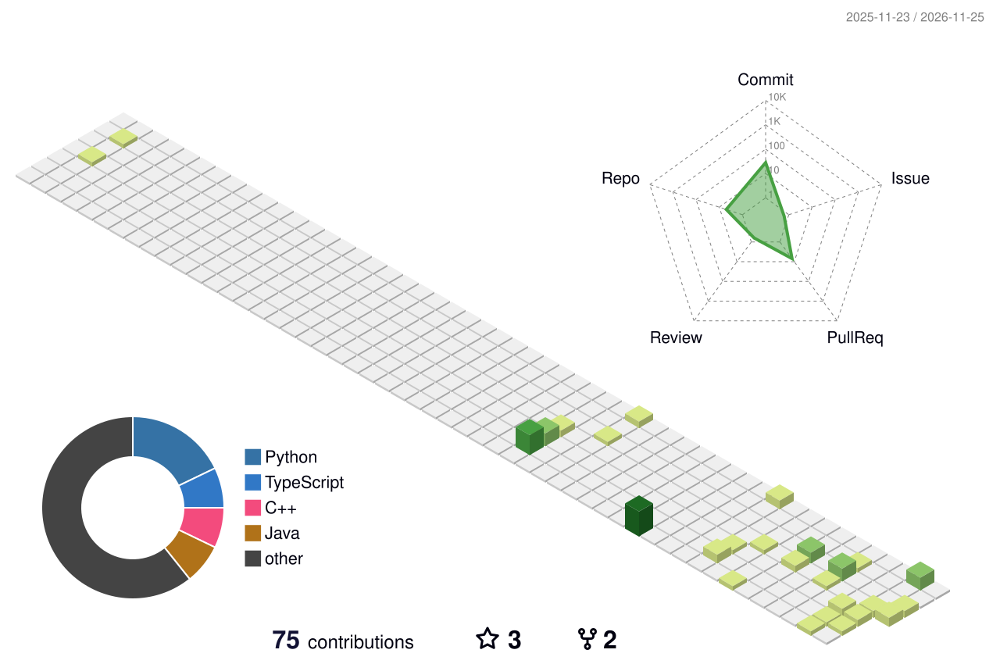

  
  <!--  -->
  
  # Hi , I'm Nabeel Hussain 👨🏻‍💻
  
  
  
  
  
    
    
  

  
  [![LinkedIn Badge](https://img.shields.io/badge/LinkedIn-0077b5?logo=)](https://www.linkedin.com/in/nabeel001/) 
  
  

## 😎 About Me:

🏫 Graduate in Information Technology, from SSN College of Engineering.  
✨ Interested in Software Development, Data Science, Machine Learning and AI.  
🤝🏻 Open to project collaborations.  
 

## 🧰 Toolbox:

  <kbd>
    
    
    
    
    
    
    
    
    
    
    
    
    
    
    
    
    
    
    
    
    
    
    
    
    
  </kbd>

 

## ⚡ GitHub Stats:

  <picture>
    <source
      media="(prefers-color-scheme: dark)"
      srcset="https://raw.githubusercontent.com/nabeel001/nabeel001/output/github-contribution-grid-snake-dark.svg"
    />
    <source
      media="(prefers-color-scheme: light)"
      srcset="https://raw.githubusercontent.com/nabeel001/nabeel001/output/github-contribution-grid-snake.svg"
    />
    
  </picture>

  <kbd>
    <picture>
      <source
        media="(prefers-color-scheme: dark)"
        srcset="https://github-readme-streak-stats.herokuapp.com/?user=nabeel001&theme=nightowl&hide_border=true"
      />
      <source
        media="(prefers-color-scheme: light)"
        srcset="https://github-readme-streak-stats.herokuapp.com/?user=nabeel001&theme=buefy&hide_border=true"
      />
      
    </picture>
  </kbd>

   <kbd>
    <picture>
      <source
        media="(prefers-color-scheme: dark)"
        srcset="https://github-stats-extended.vercel.app/api?username=nabeel001&show_icons=true&rank_icon=github&theme=nightowl&include_all_commits=true&count_private=true&hide_border=true"
      />
      <source
        media="(prefers-color-scheme: light)"
        srcset="https://github-stats-extended.vercel.app/api?username=nabeel001&show_icons=true&rank_icon=github&theme=buefy&include_all_commits=true&count_private=true&hide_border=true"
      />
      
    </picture>
    <picture>
      <source
        media="(prefers-color-scheme: dark)"
        srcset="http://github-profile-summary-cards.vercel.app/api/cards/most-commit-language?username=nabeel001&theme=nightowl"
      />
      <source
        media="(prefers-color-scheme: light)"
        srcset="http://github-profile-summary-cards.vercel.app/api/cards/most-commit-language?username=nabeel001&theme=buefy"
      />
      
    </picture>
  </kbd>

  <kbd>
    <picture>
      <source
        media="(prefers-color-scheme: dark)"
        srcset="https://github-profile-summary-cards.vercel.app/api/cards/profile-details?username=nabeel001&theme=nightowl"
      />
      <source
        media="(prefers-color-scheme: light)"
        srcset="https://github-profile-summary-cards.vercel.app/api/cards/profile-details?username=nabeel001&theme=buefy"
      />
      
    </picture>
  </kbd>

  <kbd>
    <picture>
      <source
        media="(prefers-color-scheme: dark)"
        srcset="./profile-3d-contrib/profile-night-green.svg"
      />
      <source
        media="(prefers-color-scheme: light)"
        srcset="./profile-3d-contrib/profile-green.svg"
      />
      
    </picture>
  </kbd>

<kbd>
  
</kbd>
